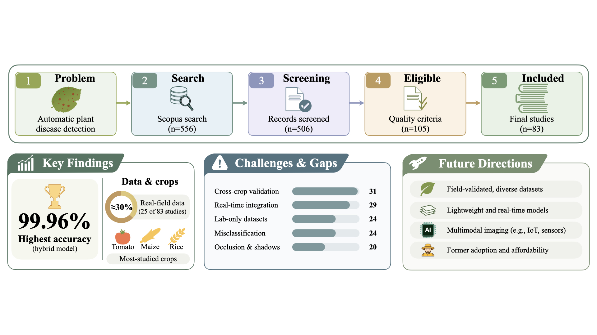

<p align="center">
  
</p>

# Deep Learning Approaches for Plant Disease Detection in Precision Agriculture: A Systematic Literature Review

This review synthesizes evidence from 83 studies on deep learning for plant disease detection. [`render_figures.py`](render_figures.py) reproduces the ten data figures (Figures 2–10 and 12) as 300 dpi PNGs.

## Run

Use Python 3.12. Place `Final-Data.xlsx`, `study_references.csv`, `keyword_membership.csv`, `keyword_communities.csv`, `dataset_text_aliases.csv`, and `crop_text_aliases.csv` from the article supplement in one folder.

```sh
python -m pip install matplotlib==3.11.2 numpy==2.3.5 pandas==2.2.3 Pillow==13.0.0 openpyxl==3.1.5
python render_figures.py --data-dir /path/to/supplementary-data --output figures
```

The script uses Times New Roman and a Display P3 ICC profile. macOS paths are set by default. Use `--font-dir` and `--display-p3` to specify other locations.
